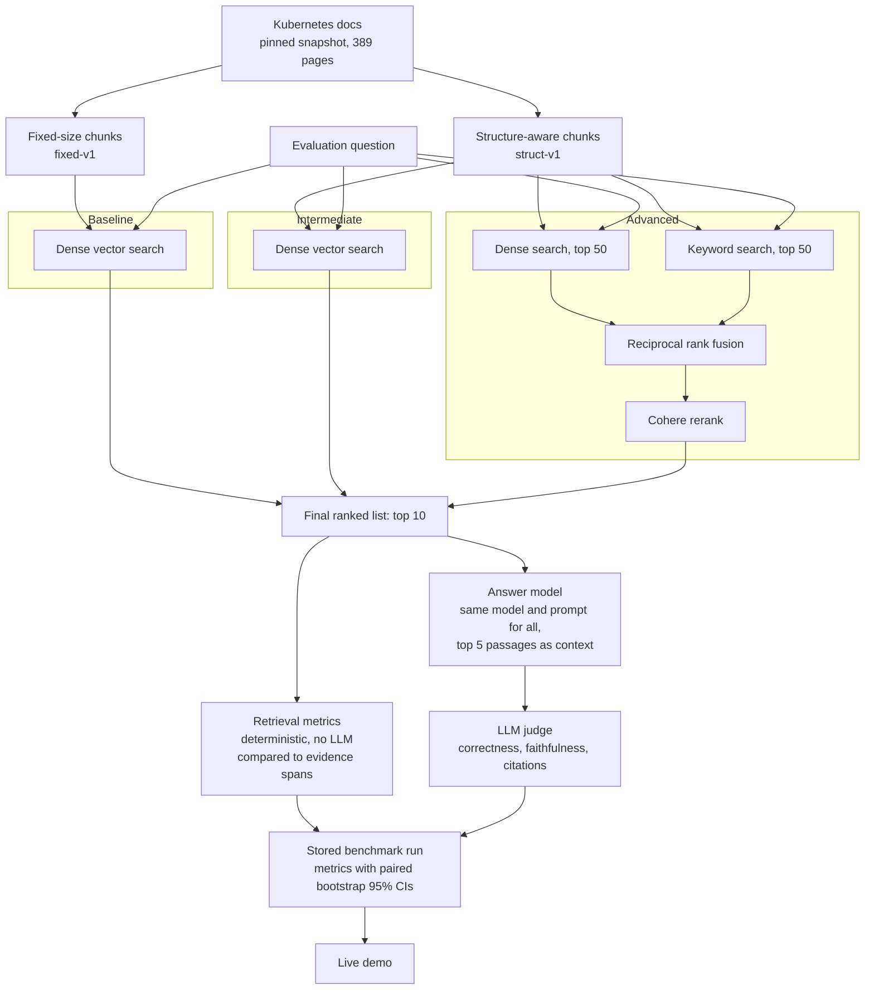
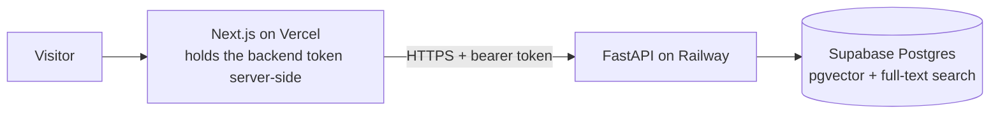

# RAG Retrieval Quality

**Most RAG demos show a chatbot. This one measures it.**

This project compares three retrieval setups on the same Kubernetes documentation and the same 55 evaluation questions, to show how much chunking, hybrid search and reranking each improve the results. For every question, it records which passages each setup retrieved, how well they matched the known evidence, what answer they produced and how that answer was judged.

**[Try the live demo](https://rag-retrieval-quality.vercel.app/)**: pick a question to compare the three setups side by side, or open the [benchmark results](https://rag-retrieval-quality.vercel.app/benchmark).

## How it works



Benchmarks run offline. The public site reads the stored results through this path:



## The three configurations

| | Chunking | Retrieval | What the comparison shows |
|---|---|---|---|
| **Baseline** | Fixed-size, about 1,600 characters | Dense only | Starting point |
| **Intermediate** | Split on headings, up to 400 tokens, with a title and section prefix | Dense only | Effect of chunking |
| **Advanced** | Same as Intermediate | Dense + keyword, fused with reciprocal rank fusion (k = 60), then reranked | Combined effect of hybrid search, fusion and reranking |

All three use the same snapshot, questions, embedding model, answer model, prompt and output limit, and all pass their top 5 chunks to the answer model.

## Results

From run [`20261105-0038-d71e`](results/20261105-0038-d71e/report.md). Differences show paired bootstrap 95% confidence intervals over questions.

| Metric | n | Baseline | Intermediate | Advanced | Intermediate − Baseline | Advanced − Intermediate |
|---|---|---|---|---|---|---|
| Hit Rate@5 | 46 | 0.804 | 0.848 | **0.935** | +0.043 (−0.065, +0.174) | +0.087 (+0.022, +0.174) |
| Recall@5 | 46 | 0.750 | 0.801 | **0.902** | +0.051 (−0.065, +0.174) | +0.101 (+0.029, +0.188) |
| Full Coverage@5, multi-section | 9 | 0.556 | 0.444 | **0.667** | −0.111 (−0.375, +0.000) | +0.222 (+0.000, +0.556) |
| MRR@10 | 46 | 0.636 | 0.651 | **0.870** | +0.015 (−0.093, +0.122) | +0.219 (+0.134, +0.312) |
| nDCG@10 | 46 | 0.572 | 0.596 | **0.735** | +0.024 (−0.047, +0.098) | +0.139 (+0.082, +0.201) |
| Answer Correctness | 46 | 0.804 | 0.804 | **0.913** | +0.000 (−0.136, +0.136) | +0.109 (+0.022, +0.208) |
| Faithfulness | 44 | 0.992 | 0.992 | **1.000** | −0.000 (−0.023, +0.022) | +0.008 (+0.000, +0.025) |
| Correct Abstention Rate | 9 | 0.889 | **1.000** | **1.000** | +0.111 (+0.000, +0.364) | +0.000 (+0.000, +0.000) |
| Mean context tokens | 55 | 1,684 | **1,124** | 1,230 | −560 (−621, −500) | +106 (+46, +166) |
| Latency p50, ms (see limitations) | 55 | 1,928 | **1,740** | 3,385 | | |

**What the results show**

- **Hybrid search and reranking gave the clearest gain.** Compared with Intermediate, Advanced improved Hit Rate, Recall, MRR, nDCG and Answer Correctness, and all five confidence intervals exclude zero.
- **Better chunking alone showed no clear quality gain.** Intermediate's changes in retrieval and answer quality are all within the margin of error, and it scored lower on the 9 multi-section questions. It did use about a third less context.
- **The gain has a latency cost.** Advanced's median response was slower, though rate limiting inflated its timings (see limitations).

The full table, including the metrics left out here, is in the [run report](results/20261105-0038-d71e/report.md). Per-question results are in [`per_question.jsonl`](results/20261105-0038-d71e/per_question.jsonl).

## How it is measured

- **Evidence is marked by character position.** Each question's evidence is stored as character ranges over the normalized text, not as chunk IDs, so setups that cut the text differently are scored fairly. A chunk covers a span when it overlaps at least 50% of it.
- **Retrieval metrics use no LLM.** They are deterministic and cover the 46 answerable questions.
- **Answers are judged separately.** An LLM judge compares each answer with the reference answer and source evidence, and checks each claim against the retrieved context. This catches answers that are faithful to the wrong passage.
- **Abstention is detected exactly.** When the context lacks the answer, the model must reply `NOT_IN_DOCS: <explanation>`. Abstaining on an answerable question counts as incorrect.
- **Runs can be traced.** Each run records its code version, snapshot, dataset, model IDs and prompt hashes.

### Dataset

`k8s-eval-v0` has 55 active questions: 20 single-section, 9 exact-term, 9 multi-section, 9 unanswerable and 8 near-duplicate. Another 41 candidates were rejected and stay in [the file](datasets/k8s-eval-v0.jsonl), excluded from scoring.

An LLM generated all the questions. Every active item was then reviewed: **7 by the author and 48 by Claude on the author's behalf**, as recorded in each item's `reviewer` field.

### Judge validation

A sample of judge output was labeled a second time and compared with the judge:

| Metric | n | Agreement | Cohen's kappa | Status |
|---|---|---|---|---|
| Answer Correctness | 18 | 94.4% | 0.769 | Usable |
| Faithfulness | 28 | 100% | 1.000 | Usable |
| Citation Correctness | 28 | 32.1% | 0.089 | **Unreliable** |

The second-pass labels come from [`judge_validation_claude_labeled.csv`](results/20261105-0038-d71e/judge_validation_claude_labeled.csv), so this is a check between two models, not validation by an independent human. Every disagreement is listed in [`judge_validation.json`](results/20261105-0038-d71e/judge_validation.json).

## Limitations

- **Small sample.** With 55 questions, and only 9 multi-section and 9 unanswerable, confidence intervals are wide. There is also only one corpus and one run.
- **Same model for answers and judging.** `gpt-6-luna` generated the questions, validated them, wrote the answers and judged them, so the judge isn't independent of the answer model.
- **Citation metrics aren't reliable.** The models usually put citations after the period, as in `Sentence. [C1]`, and the sentence splitter moves those tags to the next sentence or leaves them on their own. In this run, 165 of 336 split sentences began with a citation tag. Citation Correctness and Uncited Claim Rate are therefore left out of the table above.
- **Advanced's latency is inflated.** The run used a rate-limited Cohere trial key, and 20 of 55 Advanced questions show a rerank stage of 60 seconds or more, consistent with the code's 60-second retry wait. That accounts for the reported p95 of 68,473 ms. The other 35 questions had a median of about 2,971 ms.
- **Costs aren't reported.** Prices were not filled in for this run, so the estimated cost is empty.
- **Advanced's parts aren't separated.** The run doesn't show how much hybrid search, fusion and reranking each contributed.

## Tech stack

| Role | Choice |
|---|---|
| Frontend | Next.js on Vercel |
| Backend | Python and FastAPI on Railway |
| Database | Supabase Postgres with pgvector (exact cosine search) and full-text search |
| Embeddings | OpenAI `text-embedding-3-small`, 1,536 dimensions |
| Reranker | Cohere `rerank-v3.5` |
| Answers, judging and question generation | OpenAI `gpt-6-luna` |
| Tracing | Arize Phoenix, local only |

## Run it yourself

You need Python 3.12, [uv](https://docs.astral.sh/uv/), a Supabase project, and OpenAI and Cohere API keys.

**1. Install and configure**

```bash
uv sync
```

```bash
cp .env.example .env
```

Fill in `.env`, then run `sql/001_schema.sql` and `sql/002_functions.sql` in the Supabase SQL editor.

**2. Run the tests**

```bash
uv run pytest -q
```

**3. Get the docs at the pinned commit**

The published snapshot used commit `96dc460e7f82a376d33fa1f11437fe6175c65c1a`.

```bash
git clone --filter=blob:none --sparse https://github.com/kubernetes/website.git data/sources/k8s-website
```

```bash
git -C data/sources/k8s-website sparse-checkout set content/en/docs/concepts content/en/docs/tasks
```

```bash
git -C data/sources/k8s-website checkout 96dc460e7f82a376d33fa1f11437fe6175c65c1a
```

**4. Build the index**

Set `SNAP` to the snapshot ID the first command prints.

```bash
uv run python -m ragdemo.snapshot --corpus k8s
```

```bash
uv run python -m ragdemo.index --snapshot $SNAP
```

```bash
uv run python -m ragdemo.verify chunks --snapshot $SNAP
```

**5. Run the benchmark**

The repo has no command for loading the published [`k8s-eval-v0`](datasets/k8s-eval-v0.jsonl) file into a new database, so these steps build, review and freeze your own dataset. The review step is interactive.

```bash
uv run python -m ragdemo.evalset.build --snapshot $SNAP --name k8s-eval --scale 1.6
```

```bash
uv run python -m ragdemo.evalset.validate --snapshot $SNAP --name k8s-eval
```

```bash
uv run python -m ragdemo.evalset.review --name k8s-eval --reviewer "<your name>"
```

```bash
uv run python -m ragdemo.evalset.freeze --name k8s-eval --version my-eval-v0
```

Then start the run, setting `RUN` to the run ID the first command prints.

```bash
uv run python -m ragdemo.benchmark new --snapshot $SNAP --dataset my-eval-v0 --notes "my run"
```

```bash
uv run python -m ragdemo.benchmark generate --run $RUN --workers 4
```

```bash
uv run python -m ragdemo.benchmark judge --run $RUN --workers 4
```

```bash
uv run python -m ragdemo.benchmark score --run $RUN
```

```bash
uv run python -m ragdemo.report --run $RUN
```

Answers can vary between runs, so your numbers may differ from the published ones.

**6. Run the API**

Set `BACKEND_TOKEN`, `PUBLISHED_RUN_ID` and `PUBLISHED_SNAPSHOT_ID` in `.env` first.

```bash
uv run uvicorn ragdemo.api:app --reload --port 8000
```

Then set `BACKEND_URL` and `BACKEND_TOKEN` for the frontend and start it from `frontend/` with `npm install` and `npm run dev`. Free-text questions are behind `ASK_ENABLED` and are off by default. Those answers have no ground truth, so they aren't scored.

## Preset questions

The demo's presets were hand-picked from reviewed questions in the published run, as recorded in [`config/presets.yaml`](config/presets.yaml). They illustrate specific behaviors and are not a representative sample, so use the benchmark results to compare the setups.

Selection criteria:

- At least one question where Baseline misses and Advanced hits (q0062, q0018)
- At least one where Baseline and Advanced do equally well (q0017)
- At least one exact-term question (q0067, q0062)
- At least one multi-section question (q0069)
- At least one unanswerable question (q0093)
- Review status is `accepted` or `edited`

## Repository layout

```text
src/ragdemo/   Pipelines, metrics, benchmark runner, judge and API
config/        Pipeline settings, prompts, presets and provider details
datasets/      Frozen evaluation dataset
results/       Exported benchmark results
sql/           Database schema and search functions
frontend/      Next.js app
tests/         Unit tests
```

## Attribution

Source content: Kubernetes Documentation, © The Kubernetes Authors, licensed under [CC BY 4.0](https://creativecommons.org/licenses/by/4.0/). Normalized and chunked (modified).
